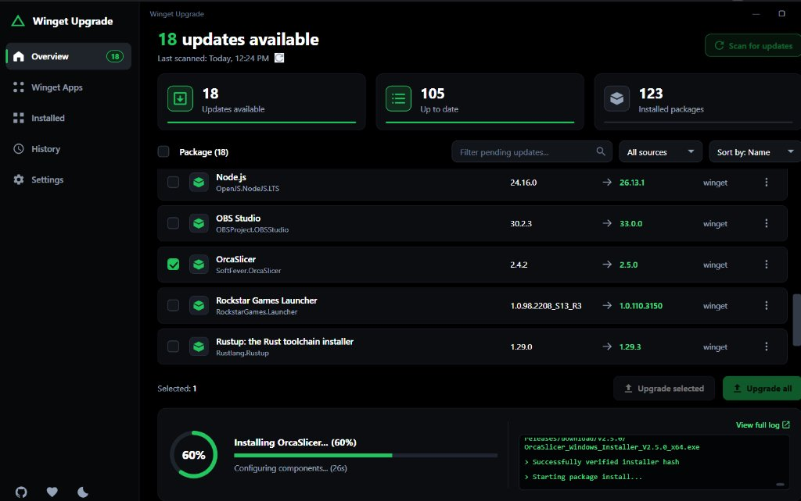

# 🚀 Winget Upgrade

A sleek, hardware-accelerated desktop client for **Windows Package Manager (`winget` CLI)** built with **.NET 8 WPF**. 

It transforms the command-line winget experience into a fast, responsive, and visually modern dashboard with real-time logs, process control, and package management.

<p align="center">
  
</p>

---

## 📸 Key Capabilities

- **⚡ High-Performance Virtualization:** Smooth 60fps scrolling across hundreds of installed packages without UI lag or memory bloat.
- **🎨 Modern Dark & OLED Themes:** Fluent dark aesthetic with neon-green accents, custom slim scrollbars, and a toggleable **Pure Black OLED Mode**.
- **📋 Integrated Sidebar Console:** Live execution output directly embedded in the left sidebar with automated autoscroll to monitor real-time winget activities.
- **🛑 Force Process Cancellation:** Dedicated cancellation mechanism that cleanly terminates active winget subprocess trees on demand.
- **👁️ Package Ignore System:**
  - Temporarily or permanently ignore problematic updates directly from the **3-dots menu**.
  - Review and restore ignored packages at any time through the **Settings** panel.
- **📦 Batch & Individual Upgrades:** Upgrade individual software packages or perform bulk upgrades with multi-select checkboxes.
- **🛡️ Silent Admin Elevation:** Automatically requests administrator elevation to ensure unattended, quiet package installations.

---

## 🧠 How It Works (Internal Architecture)

Winget Upgrade follows the **MVVM (Model-View-ViewModel)** architectural pattern with asynchronous service boundaries:

```
┌────────────────────────────────────────────────────────┐
│                   WPF User Interface                   │
│   (MainWindow.xaml, Virtualized Lists, Sidebar Logs)   │
└───────────────────────────▲────────────────────────────┘
                            │ Data Binding & Commands
┌───────────────────────────▼────────────────────────────┐
│                      MainViewModel                     │
│  - Reactive ObservableCollections (Packages, History)   │
│  - Filter, Sort, & Selection State Management          │
│  - Cancel, Ignore, & Upgrade Command Orchestration     │
└───────────────────────────▲────────────────────────────┘
                            │
┌───────────────────────────┴────────────────────────────┐
│                    Service Layer                       │
│                                                        │
│  ┌─────────────────────────┐  ┌─────────────────────┐  │
│  │      WingetService      │  │   SettingsService   │  │
│  │ - Async CLI Invocation  │  │ - JSON Persistence  │  │
│  │ - Regex Stream Parser   │  │ - Ignored App IDs   │  │
│  │ - Process Tree Killer   │  │ - User Preferences  │  │
│  └────────────▲────────────┘  └─────────────────────┘  │
└───────────────┼────────────────────────────────────────┘
                │ stdout / stderr streaming
┌───────────────▼────────────────────────────────────────┐
│              Windows Package Manager CLI               │
│                     (winget.exe)                       │
└────────────────────────────────────────────────────────┘
```

### 1. Asynchronous Process Execution (`WingetService`)
The application executes native `winget.exe` commands in background threads without locking the WPF UI dispatcher. Standard output and error streams are redirected and read asynchronously line-by-line.

### 2. Stream Parsing & Live Metrics
CLI output is matched against regex patterns to extract real-time download percentages, transfer rates, package verification statuses, and exit codes. These are forwarded instantly to:
- The circular progress indicator and status bar.
- The sidebar terminal log buffer.

### 3. Fault-Tolerant Process Termination
When the user triggers **Cancel update**, the service walks the process hierarchy and forcefully terminates both the active winget wrapper and spawned vendor installer binaries (e.g., Inno Setup, MSI, Nullsoft), ensuring no lingering background locks.

### 4. Settings & Ignore Persistence (`SettingsService`)
Preferences, ignored package IDs, and upgrade histories are persisted locally in `%LocalAppData%\WingetUpgrade\settings.json`. Ignored packages are filtered out of subsequent upgrade scans automatically.

---

## 🖥️ Application Sections

### 1. Overview Dashboard
- **Top Metric Cards:** Instant counts for pending updates, up-to-date applications, and total installed packages.
- **Search & Filter Bar:** Live text search, source filtering (`winget`, `msstore`), and sorting (Name, ID, Source).
- **Package Row Actions:**
  - Checkbox selection for batch upgrades.
  - 3-dots action menu: **Upgrade now**, **Ignore this update**, and **Copy Package ID**.
- **Bottom Status Card:** Wide progress bar with current package status and a **Cancel update** button.

### 2. Winget Apps Catalog
- Browse curated collections of popular developer, productivity, and utility tools.
- Category filtering with one-click direct installations.

### 3. Installed Packages
- Complete inventory of software installed on your machine.
- Searchable by name and package ID with quick copy functionality.

### 4. Upgrade History
- Chronological audit log of all updates performed through the application with date and version transitions.

### 5. Settings & Diagnostics
- General options: Launch update scan, include unknown versions, unattended mode toggle, OLED black theme.
- **Ignored Packages Manager:** Dedicated card listing all hidden apps with one-click **Unignore** buttons.
- Diagnostics: Clear console buffer, view complete session log dialog, clear history, and cache re-sync.

---

## 🚀 Getting Started

### System Requirements
- **OS:** Windows 10 (1809+) or Windows 11
- **Runtime:** [.NET 8.0 Desktop Runtime](https://dotnet.microsoft.com/download/dotnet/8.0) or SDK
- **Package Manager:** `winget` (Windows Package Manager, included by default with modern Windows)

### Running from Source

Clone the repository:
```bash
git clone https://github.com/tusharrkabir/WingetUpgrade.git
cd WingetUpgrade
```

Run with elevated privileges using the included script:
```cmd
Run.bat
```

Or run via the .NET CLI:
```bash
dotnet run --project WingetUpgrade/WingetUpgrade.csproj
```

### Compiling a Release Binary
```bash
dotnet publish WingetUpgrade/WingetUpgrade.csproj -c Release -r win-x64 --self-contained false -o ./publish
```

---

## 📁 Repository Structure

```
├── assets/
│   └── screenshots/       # Dashboard & UI preview images
├── WingetUpgrade/
│   ├── Controls/          # Custom UI elements (e.g., CircularProgressBar)
│   ├── Converters/        # Value converters for boolean/visibility bindings
│   ├── Models/            # PackageItem and HistoryItem schemas
│   ├── Services/          # WingetService, SettingsService, PopularAppsCatalog
│   ├── Themes/            # Styles.xaml (modern dark templates), Icons.xaml (SVG vector geometries)
│   ├── ViewModels/        # MainViewModel, ViewModelBase (reactive commands and state)
│   ├── Views/             # FullLogWindow and secondary views
│   ├── App.xaml           # Application initialization and elevation checks
│   ├── MainWindow.xaml    # Main dashboard interface
│   └── WingetUpgrade.csproj
├── Run.bat                # Administrator launch helper
├── .gitignore             # Optimized .NET / Visual Studio ignore rules
├── LICENSE                # MIT License
└── README.md              # Project documentation
```
